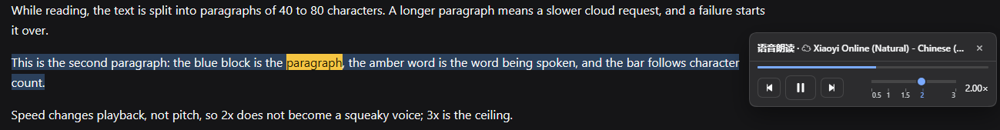
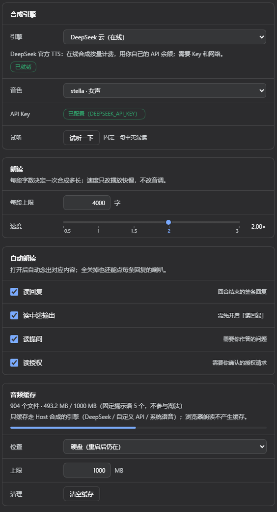
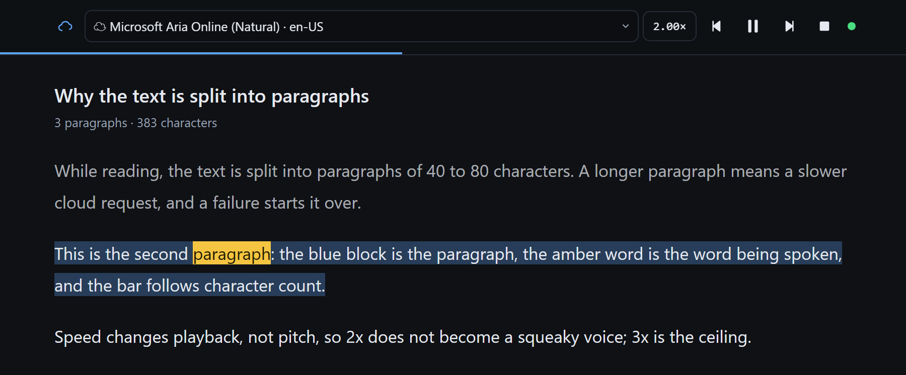

# Read aloud · dsh-tts-reader

**Have DeepSeek Harness (DSH) read its answers to you.** Click the speaker under an assistant reply and it starts talking; click again to replay from the local cache instead of paying for a second synthesis.

English · [中文](README.md)

[](LICENSE)
[](https://github.com/topics/dsh-plugin)
[](CHANGELOG.md)
[](https://www.npmjs.com/package/dsh-tts-reader)
[](#install)
[](docs/TECHNICAL.md)
[](https://github.com/nienieai/dsh-tts-reader)



## In one sentence

After installation every assistant reply gets a speaker button. Click it and DSH reads that reply out loud, highlighting the paragraph and the word it is on.

- 🔊 **One click, no copy-paste**: long answers while your eyes are busy somewhere else.
- 💾 **Pay once per paragraph**: synthesized audio is cached on your machine and replayed on the next click.
- 🔒 **The API key never leaves the Host**: the browser only receives session and message ids.
- ⚙️ **Any voice you like**: DeepSeek cloud, browser voices, system voices, or your own TTS endpoint.
- 🈶 **Speaks your language**: the interface copy ships in Chinese, English, Japanese, Spanish, French, German, Russian and Portuguese.

## Why it is worth installing

| Situation | Without it | With it |
|---|---|---|
| Long answers, docs | read line by line | listen while doing something else, highlight follows along |
| Tired eyes, commuting, cooking | can't look at the screen | auto-read reads each finished reply |
| Only need one part | scroll and skim | select the text, click the speaker, only that paragraph is read |
| Don't want to pay per character | cloud TTS bills by text | browser voices, system voices or local Piper — offline and free |
| Want a natural voice | system voices sound robotic | plug in Azure / OpenAI / SiliconFlow or any compatible endpoint |

## Five engines, pick one

Switch any time in **Settings → Read aloud → Engine**:

| Engine | Where the voice comes from | Online | Best for |
|---|---|---|---|
| **DeepSeek cloud** | the official DeepSeek TTS API (stella / tide) | ✅ | default, works out of the box |
| **Speech bridge** (desktop) | hands the text to your default browser; pause, step, word-level highlight | ➖ | the most natural, full control |
| **Browser voices** | voices already installed in the OS | ➖ | zero setup, fastest first sound |
| **System voices** | Windows SAPI / macOS `say` / Linux `espeak-ng` | ❌ | fully offline, mechanical sound |
| **Custom API** | OpenAI-compatible, GPT-SoVITS, Fish Audio, or your own template | ✅ | you already run a TTS service |

The default **DeepSeek cloud** engine needs `DEEPSEEK_API_KEY` configured in DSH; without it the settings page says so instead of pretending to work.

## Install

You need **DeepSeek Harness** installed (desktop or web; the speech bridge only appears in the desktop shell).

**Option 1 — from the plugin page (recommended)**

1. Open DSH → **Plugins** → **Add plugin**;
2. pick this repository's directory (the one holding `package.json`);
3. refresh the page — the speaker shows up under assistant replies.

**Option 2 — command line**

```bash
git clone https://github.com/nienieai/dsh-tts-reader.git
dsh plugin --profile desktop add link:./dsh-tts-reader
```

**Option 3 — from npm (no clone needed)**

```bash
dsh plugin --profile desktop add dsh-tts-reader
```

Pin a version with `dsh-tts-reader@0.5.3`. Refresh afterwards; if the plugin is listed but switched off, turn it on.

> Refresh the page to load the client half; changes to the Host half (`index.js`) need a DSH restart.

Detailed install, uninstall and offline (Piper) steps: **[docs/INSTALL.md](docs/INSTALL.md)**.

## Using it

- **Read a reply**: click 🔊 in the reply's action row. Click again while playing to stop.
- **Read a selection**: select text first, then click the speaker — it reads the paragraph(s) the selection sits in.
- **Floating player**: appears bottom-right while reading, draggable and position-remembered. Previous / pause-resume / next, drag the speed slider for instant change, click a tick for 0.5×–3×, × stops and clears the queue.
- **Auto-read**: enable "Read replies" in settings to read the final reply of each turn; "Read mid-turn output" reads streamed chunks too. Questions and approvals are read separately and can be turned off.
- **Speech bridge** (desktop): switch the engine to "Speech bridge" and the reply is handed to a dedicated page in your browser with a voice list, click-to-read paragraphs, paragraph/word highlighting and richer playback controls.

## What it looks like

**Settings**: engines, voices, paragraph size, auto-read and the audio cache all live on one page.



*The settings panel is shown in Chinese here; its wording follows your DSH language.*

**Speech bridge**: on desktop the reply is handed to a dedicated reading page in your browser — title, paragraphs, progress, and clicking any paragraph reads from there.



## Privacy and data

- The browser never sees the API key and cannot change the endpoint; only the DSH Host process reads the conversation and calls the API.
- Only the text being read is sent — not the whole session, not the reasoning.
- Audio is cached under `~/.dsh/cache/dsh-tts/`, 200 MB by default, least-recently-used eviction; you can clear it in settings.
- Every route only accepts **loopback + same-origin** requests, so other web pages cannot trigger synthesis or edit your settings.

## FAQ

**Nothing happens when I click?**
Watch the button: a spinner means the bridge is starting (the first launch is slower); a yellow exclamation mark means the bridge page needs one click on ▶ (browsers block sound before a gesture); red means synthesis failed — hover for the reason.

**Does it cost money?**
The DeepSeek cloud engine bills per the official TTS pricing; browser voices, system voices and local Piper are free. A cache hit is never billed twice.

**Can it work offline?**
Yes: system voices or local Piper. Piper needs an executable and a model you download yourself (the plugin does not ship them) — see the install guide.

**Does it read code and tables?**
Not word by word. Code blocks, tables, formulas and images each produce one short spoken marker ("here is a code block"), keeping the audio clean.

**How fast can it go?**
0.5×–3.0× with pitch preserved; the slider carries 0.5 / 1 / 1.5 / 2 / 3 ticks you can click.

## Docs

| Document | Contents |
|---|---|
| [docs/INSTALL.md](docs/INSTALL.md) | install, uninstall, local Piper, troubleshooting |
| [docs/TECHNICAL.md](docs/TECHNICAL.md) | architecture, routes, cache keys, engines, tests, release |
| [CHANGELOG.md](CHANGELOG.md) | what changed in each version |
| [THIRD_PARTY.md](THIRD_PARTY.md) | third-party code and licenses |
| [CONTRIBUTING.md](CONTRIBUTING.md) | dev setup, branch model, commit rules |
| [SECURITY.md](SECURITY.md) | security model and reporting |

## Contributing

Issues and pull requests are welcome. `main` holds released versions only; `dev` is the working branch. Branch off `dev` and open the PR against `dev` (the base defaults to `main`). Run the local checks before sending a change — see [CONTRIBUTING.md](CONTRIBUTING.md).

If this plugin saves you time, a ⭐ is the best thanks.

## Notes

- **How it was built**: the code and documentation were written with the help of **AI agent tooling**; a human set the direction and signed off on it.
- **Translations**: the interface copy in the seven non-Chinese languages (English, 日本語, Español, Français, Deutsch, Русский, Português) was translated by AI agents and may read awkwardly or be imprecise. Fixes are very welcome — see [CONTRIBUTING.md](CONTRIBUTING.md).
- **Credit**: the idea behind the read-aloud bridge comes from [dsh-tts-bridge](https://github.com/Yuuyuko-uu/dsh-tts-bridge) by Yuuyuko-uu, which hands DSH session text to the browser / the DeepSeek web app to speak. This plugin's bridge is an **independent implementation**: it speaks through the browser's built-in SpeechSynthesis (no DeepSeek web app involved), and none of that project's code or text was copied. That project uses the author's own license, not MIT — see [THIRD_PARTY.md](THIRD_PARTY.md).

## License

[MIT](LICENSE) © dsh-tts-reader contributors

This is an **unofficial community plugin**, not affiliated with or endorsed by DeepSeek. The name "DeepSeek" only describes the API it talks to. Third-party code and notices: [THIRD_PARTY.md](THIRD_PARTY.md).
