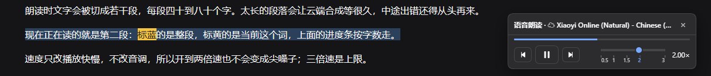
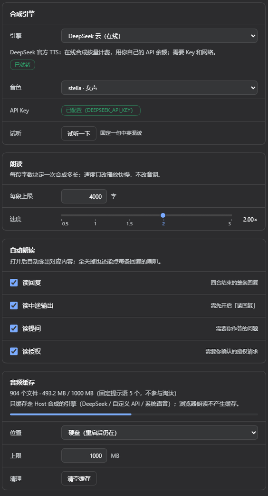
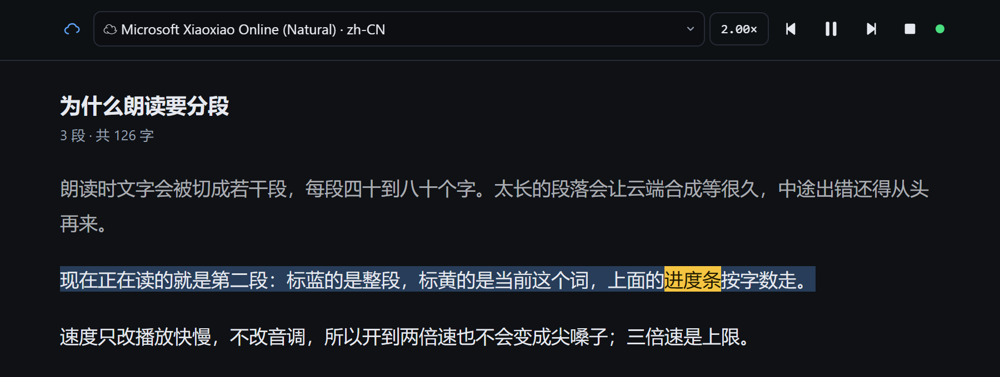

# 语音朗读 · dsh-tts-reader

**让 DeepSeek Harness（DSH）把回答念出来。** 点一下助手回复下面的喇叭，就能听它说话；再点一次直接放缓存，不重新合成。

[English](README.en.md) · 中文

[](LICENSE)
[](https://github.com/topics/dsh-plugin)
[](CHANGELOG.md)
[](https://www.npmjs.com/package/dsh-tts-reader)
[](#安装)
[](docs/TECHNICAL.md#语言与主题)
[](https://github.com/nienieai/dsh-tts-reader)



## 一句话

装好之后，每条回复下面会多一个喇叭按钮。点它，DSH 就会把这条回复念给你听；读到哪一段、哪个词，页面上都标得出来。

- 🔊 **点一下就听**：不用复制、不用切窗口，长回答也不用一直盯屏幕。
- 💾 **听过的不再付费**：合成好的音频缓存在本机，再点同一段直接回放。
- 🔒 **Key 不出本机**：浏览器只拿消息编号，真正调用接口、存放密钥的只有 DSH 自己的后台进程。
- ⚙️ **能换声音**：云端音色、浏览器自带语音、系统语音、你自建的任何 TTS 服务，都能接。
- 🈶 **跟着 DSH 走**：中文、English、日本語、Español、Français、Deutsch、Русский、Português 八种界面文案。

## 为什么值得装

| 场景 | 没有它 | 装上之后 |
|---|---|---|
| 长回答、技术文档 | 一行行读 | 边听边做别的，段落和词高亮跟着走 |
| 眼睛累 / 通勤 / 做饭 | 没法看屏幕 | 自动朗读，回合结束时念完整条回答 |
| 只想听重点 | 自己扫 | 选中要听的文字再点喇叭，只念那一段 |
| 不想花钱 | 云端 TTS 按字计费 | 用浏览器语音、系统语音或本地 Piper，离线零成本 |
| 想要自然的声音 | 系统音机械 | 接 Azure / OpenAI / SiliconFlow 等任意兼容端点 |

## 五种声音，任选

在 **设置 → 语音朗读 → 引擎** 里切换，随时可换：

| 引擎 | 声音从哪来 | 联网 | 适合 |
|---|---|---|---|
| **DeepSeek 云** | DeepSeek 官方 TTS（stella / tide） | ✅ | 默认，开箱即用 |
| **朗读桥**（桌面端） | 交给默认浏览器朗读，可暂停、翻段、逐词高亮 | ➖ | 最自然、控制最全 |
| **浏览器语音** | 系统里已装的中文语音（如 Microsoft Huya/Huihui） | ➖ | 零配置，最快出声 |
| **系统语音** | Windows SAPI / macOS `say` / Linux `espeak-ng` | ❌ | 完全离线，音质偏机械 |
| **自定义 API** | OpenAI 兼容、GPT-SoVITS、Fish Audio 或自填模板 | ✅ | 已有自己的 TTS 服务 |

第一次用建议留默认的 **DeepSeek 云**；它需要 DSH 里已经配好的 `DEEPSEEK_API_KEY`，没有 Key 时设置页会直接标红，不会假装能用。

## 安装

前提：已经装好 **DeepSeek Harness**（桌面端或 Web 端均可，朗读桥只在桌面端出现）。

**方式一：从插件页安装（推荐）**

1. 打开 DSH → **插件** → **添加插件**；
2. 选择本仓库目录（就是含 `package.json` 的那层）；
3. 装好后刷新页面，助手回复下面就出现喇叭了。

**方式二：命令行**

```bash
git clone https://github.com/nienieai/dsh-tts-reader.git
dsh plugin --profile desktop add link:./dsh-tts-reader
```

**方式三：从 npm（不用克隆仓库）**

```bash
dsh plugin --profile desktop add dsh-tts-reader
```

要固定版本就写 `dsh-tts-reader@0.5.3`。装完刷新页面；如果插件列表里它还是关着的，把开关打开。

> 装完要**刷新页面**让界面部分加载；Host 部分（`index.js`）的改动需要重启 DSH 才生效。

更细的安装、卸载、离线（Piper）步骤见 **[docs/INSTALL.md](docs/INSTALL.md)**。

## 开始朗读

- **念一条回复**：点回复下方操作行的 🔊。播放中再点一下 = 停止。
- **只念选中内容**：先选中文字，再点喇叭，会念选区所在的整段（选在段中间也行，会补齐整段）。
- **悬浮窗**：朗读时右下角出现，可拖动、记住位置。上一段 / 暂停·继续 / 下一段，拖滑条立刻变速，点刻度直接切 0.5×–3×，× 停止并清空队列。
- **自动朗读**：设置里打开「读回复」，每个回合结束时自动念完最后一条回答；再开「读中途输出」可以边生成边念。提问和授权请求会单独念，且可以各自关掉。
- **朗读桥**（桌面端）：设置里把引擎换成「朗读桥」，回复会交给默认浏览器里一个专门的朗读页——那里有音色列表、逐段点读、段落和字词高亮、以及更细的播放控制。

## 长什么样

**设置页**：引擎、音色、每段字数、自动朗读、音频缓存，都在这一页里。



**朗读桥**：桌面端把回复交给浏览器里一个专门的朗读页，标题、段落、进度都在，点哪段就从哪段读。



## 隐私与数据

- 浏览器**拿不到** API Key，也改不了接口地址；只有 DSH 的后台进程读取会话正文并调用接口。
- 发出去的只有**要念的那段文字**，不发整段会话、不发思考过程。
- 音频缓存在本机 `~/.dsh/cache/dsh-tts/`，默认上限 200 MB，超出按最久未用淘汰；设置里可清空。
- 所有接口只接受**本机回环地址 + 同源**请求，别的网页无法偷偷触发合成或改你的配置。

## 常见问题

**点了没反应？**
先看喇叭有没有变成转圈或波浪：转圈 = 正在启动朗读（朗读桥首次打开会慢一点）；黄色感叹号 = 需要你在朗读桥页面点一下 ▶（浏览器不允许页面自己发声）；红色 = 合成失败，悬停能看到原因。

**需要付费吗？**
DeepSeek 云按官方 TTS 计费；浏览器语音、系统语音、本地 Piper 完全免费。缓存命中时不会重复计费。

**能离线吗？**
能。系统语音或本地 Piper 都可以，Piper 需要你自己下载可执行文件和模型（插件不分发，见安装文档）。

**会不会念代码和表格？**
不会逐字念。代码块、表格、公式、图片会各念一句固定提示（「这里是代码块」等），避免噪音。

**能念多快？**
0.5×–3.0×，变速不变调；滑条上有 0.5 / 1 / 1.5 / 2 / 3 五个刻度可以直接点。

## 文档

| 文档 | 内容 |
|---|---|
| [docs/INSTALL.md](docs/INSTALL.md) | 安装、卸载、本地 Piper、排错 |
| [docs/TECHNICAL.md](docs/TECHNICAL.md) | 架构、接口、缓存键、引擎实现、测试与发版 |
| [CHANGELOG.md](CHANGELOG.md) | 每个版本改了什么 |
| [THIRD_PARTY.md](THIRD_PARTY.md) | 第三方代码与许可证 |
| [CONTRIBUTING.md](CONTRIBUTING.md) | 开发环境、分支模型、提交规范 |
| [SECURITY.md](SECURITY.md) | 安全模型与漏洞报告 |

## 参与

欢迎提 Issue、提 PR。仓库约定：`main` 只放已发布版本，`dev` 是日常开发线；提交前请跑一遍本地检查（见 [CONTRIBUTING.md](CONTRIBUTING.md)）。

如果这个插件帮你省了时间，给个 ⭐ 就是最好的支持。

## 声明

- **开发方式**：代码与文档由 **AI Agent 工具**辅助完成，人类负责方向、取舍与验收。
- **翻译**：中文以外的七种界面文案（English / 日本語 / Español / Français / Deutsch / Русский / Português）由 AI Agent 翻译，可能有用词偏差或不自然之处；发现不准确欢迎提 Issue 或 PR（见 [CONTRIBUTING.md](CONTRIBUTING.md)）。

## 许可证

[MIT](LICENSE) © dsh-tts-reader contributors

本插件是**非官方社区项目**，与 DeepSeek（深度求索）没有隶属或背书关系；名称里的 “DeepSeek” 只用于说明它对接的接口。参考过的开源项目与版权声明见 [THIRD_PARTY.md](THIRD_PARTY.md)。
